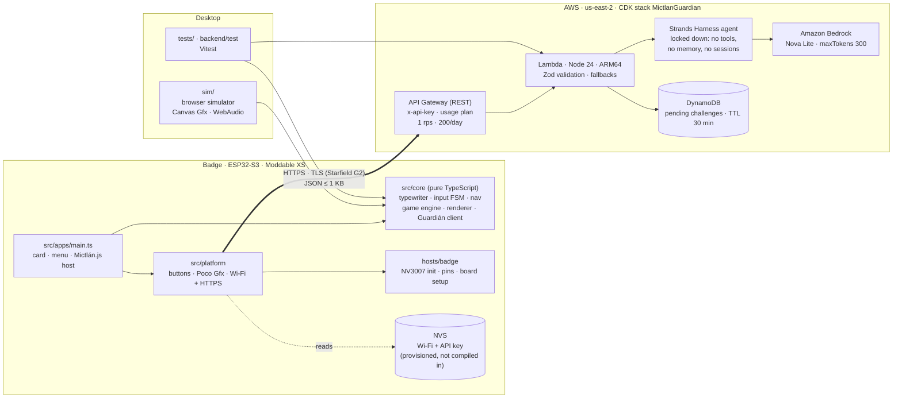
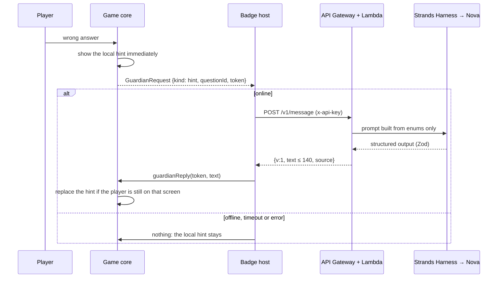

# Hazel Badge OS

Custom firmware for the Electronic Cats **JSConf México 2026** badge, with every app written in **TypeScript** and running on the badge's own JavaScript engine (Moddable SDK / XS).

Hardware: ESP32-S3-WROOM-1 (no PSRAM), 8 MB flash, NV3007 2.79" color TFT (428×142), 4 front buttons, 915 MHz LoRa module.

```
>_ whoami
Hazel Sáenz
Developer Advocate @ AWS
SERVERLESS · GENAI · LATAM
```

## Status

| Phase | What | State |
|---|---|---|
| 1 | Animated digital business card: typing intro, `whoami`, menu, card, GitHub profile, links + QR | ✅ On the badge |
| 2 | **Mictlán.js**: Día de Muertos frog auto-runner with 4 JavaScript challenges and chiptune sound | ✅ On the badge (22–31 fps) and in the browser simulator |
| 3 | **El Guardián del Código**: AI hints, cheers and farewells from Strands Harness + Amazon Bedrock (Nova Lite) | ✅ Backend live in us-east-2 · ✅ Badge goes online over Wi-Fi (phone hotspot) |

Known issues and next steps are listed [at the end](#known-issues).

## Architecture



**One codebase, three runtimes.** Everything in `src/core` is pure TypeScript with no device APIs. The same game engine, renderer and Guardián client run on the badge (Moddable XS), in the browser simulator, and under Vitest in Node. Only the thin adapters differ:

| Concern | Badge (`src/platform`, `hosts/badge`) | Simulator (`sim/`) |
|---|---|---|
| Drawing | Commodetto Poco + JetBrains Mono TTF, panel-safe palette | Canvas 2D, ×3 pixelated |
| Input | ECMA-419 `Digital` on GPIO 40/43/18/1, debounced by `core/inputFsm` | Keyboard |
| Sound | Events emitted; no buzzer on the board yet | WebAudio square/triangle |
| Network | Wi-Fi scan → connect → NTP → HTTPS `fetch` | Simulated replies (`?online=1`) |

### Online Guardián flow



Design rules behind it:
- **Offline first.** The game never waits on the network. Local text shows immediately, and an AI reply replaces it only if it arrives while the player is still on that screen (tokens per screen; stale replies are dropped).
- **No free text reaches the model.** Requests carry only enums and numbers, validated with `.strict()` Zod schemas on both ends.
- **The badge never learns the answer** to an online challenge. The server keeps it in DynamoDB and checks submissions. AI-written challenges are only accepted after the server **runs the code** in a sandbox and confirms the marked answer.
- **Secrets stay out of the firmware and the repo.** Wi-Fi and the API key live in NVS, written from a separate image.

More detail: [`docs/architecture.md`](docs/architecture.md).

## Repository layout

```
src/core/        pure TS: typewriter, inputFsm, nav, content, badgeText, netStatus, guardianClient
src/core/game/   Mictlán.js: game state machine, level, questions, sprites, palette, sound, renderer
src/apps/        badge app (Poco screens + game host)
src/platform/    Moddable adapters: buttons, Poco Gfx, Wi-Fi/HTTPS
hosts/badge/     Moddable target for this badge (NV3007 registers, pins, XS memory sizing)
sim/             browser simulator
backend/         Phase 3: Lambda + Strands Harness + CDK stack
scripts/         build-badge.sh (build only), provision-badge.py (NVS image)
tests/           Vitest suites (badge core, game, simulator audio)
docs/            hardware, architecture, game design, backup and recovery
```

## Build and run

Requires ESP-IDF v6.1 (`~/esp/esp-idf-v6.1`), the Moddable SDK (`~/Projects/moddable`), Node 20+, and `brew install cmake ninja`.

```sh
npm install
npm test                 # 142 tests: core, game, simulator, backend
./scripts/build-badge.sh # build only — never flashes; fails if XS memory won't fit in RAM
npm run sim              # simulator → http://127.0.0.1:4173/
```

Simulator controls: ↑/W jump · ↓/S crouch · Enter/Space SELECT · Esc/⌫ BACK.
Dev shortcuts: `?online=1`, `?skip=challenge&flower=2`, `?skip=feedback`, `?skip=victory`, `?skip=retry`, `?skip=pause`.

### Backend

```sh
cd backend && npm install && npm test
export AWS_PROFILE=free-tier-Strands CDK_DEFAULT_REGION=us-east-2
npm run deploy -- -c profileRegions=us-east-1,us-east-2,us-west-2 -c budgetEmail=<email>
```

Details, outputs and teardown: [`backend/README.md`](backend/README.md).

### Going online on the badge

1. Create `~/esp32-dev/secrets/wifi.env` (`chmod 600`) with `WIFI_SSID=` and `WIFI_PASSWORD=`. Use a **2.4 GHz** network. A phone hotspot works; on iPhone, turn on *Maximize Compatibility*.
2. `python3 scripts/provision-badge.py` builds `~/esp32-dev/secrets/badge-nvs.bin`. It reads the API key from the deployed stack and never prints secrets.
3. Flash the NVS image at `0x9000` (approved step, see below).
4. Open Mictlán.js. The radio starts only then, and the status shows on the title screen and in About.

## Safety

- The repo never stores flash dumps, credentials or device identifiers.
- `build-badge.sh` only builds. Flashing happens only after the pre-flash checklist in [`docs/backup-and-recovery.md`](docs/backup-and-recovery.md) and the owner's approval of the exact command.
- Verified full backups of the original firmware are kept outside the repo.
- The badge has no flash encryption, so anyone holding it can read its NVS. Use a guest or hotspot network, and revoke the per-badge API key if the badge is lost.

## Docs

- Spec: [`requirements`](.kiro/specs/hazel-badge-os/requirements.md) · [`design`](.kiro/specs/hazel-badge-os/design.md) · [`tasks`](.kiro/specs/hazel-badge-os/tasks.md)
- [Hardware discovery report](docs/hardware.md) · [Architecture](docs/architecture.md) · [Game design](docs/game-design.md) · [Backup and recovery](docs/backup-and-recovery.md)

## Known issues

- **JavaScript stack overflow while online.** The serial log showed one `XS abort: JavaScript stack overflow` during an online session; the badge rebooted and reconnected. The likely cause is the JavaScript TLS stack against the 512-slot XS stack. Under investigation.
- **Network diagnostics not yet on the badge.** Scan-first connection with specific failure reasons ("no veo la red", "contraseña", "sin internet"), the status line on the game title and 30 s retries are built and tested but not flashed yet.
- **No sound on hardware.** The board has no buzzer. Sound events are emitted and ready for a piezo on a verified free GPIO.
- **Burst throttling.** The API Gateway per-second limit did not stop a 6-request burst. The daily quota and budget alert still cap cost.
