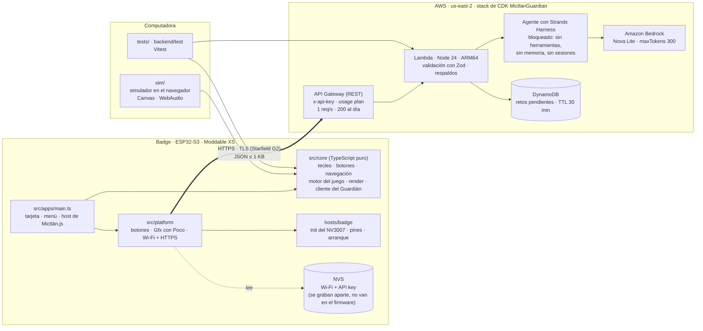
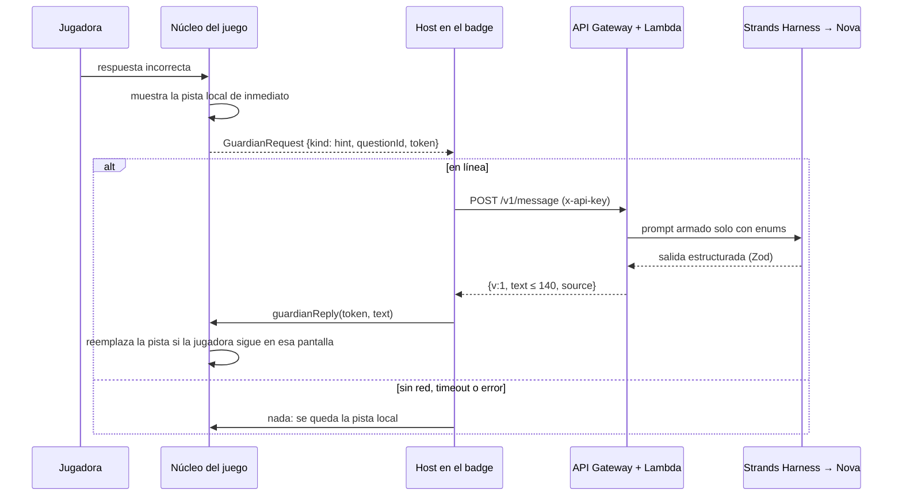

# Hazel Badge OS

**Español** · [English](README.en.md)

Firmware propio para el badge de **JSConf México 2026** de Electronic Cats. Todas las apps están escritas en **TypeScript** y corren en el motor de JavaScript del propio badge (Moddable SDK / XS).

Hardware: ESP32-S3-WROOM-1 (sin PSRAM), 8 MB de flash, pantalla TFT a color NV3007 de 2.79" (428×142), 4 botones al frente y un módulo LoRa de 915 MHz.

```
>_ whoami
Hazel Sáenz
Developer Advocate @ AWS
SERVERLESS · GENAI · LATAM
```

## Estado

| Fase | Qué es | Estado |
|---|---|---|
| 1 | Tarjeta de presentación animada: intro con tecleo, `whoami`, menú, tarjeta, perfil de GitHub, links con QR | ✅ En el badge |
| 2 | **Mictlán.js**: auto-runner de Día de Muertos con una rana, 4 retos de JavaScript y sonido chiptune | ✅ En el badge (22–31 fps) y en el simulador del navegador |
| 3 | **El Guardián del Código**: pistas, ánimos y despedidas con IA, usando Strands Harness y Amazon Bedrock (Nova Lite) | ✅ Backend en us-east-2 · ✅ El badge se conecta por Wi-Fi (hotspot del teléfono) |

Los problemas conocidos y los siguientes pasos están [al final](#problemas-conocidos).

## Arquitectura



**Un solo código, tres lugares donde corre.** Todo lo que está en `src/core` es TypeScript puro, sin APIs del dispositivo. El mismo motor del juego, el render y el cliente del Guardián corren en el badge (Moddable XS), en el simulador del navegador y en Node con Vitest. Solo cambian los adaptadores:

| Tema | Badge (`src/platform`, `hosts/badge`) | Simulador (`sim/`) |
|---|---|---|
| Dibujo | Commodetto Poco + JetBrains Mono TTF, con paleta segura para la pantalla | Canvas 2D, ×3 pixelado |
| Botones | ECMA-419 `Digital` en GPIO 40/43/18/1, con antirrebote en `core/inputFsm` | Teclado |
| Sonido | Se generan los eventos; la placa todavía no tiene buzzer | WebAudio (onda cuadrada y triangular) |
| Red | Escaneo de Wi-Fi → conexión → NTP → `fetch` por HTTPS | Respuestas simuladas (`?online=1`) |

### Cómo funciona el Guardián en línea



Las reglas de diseño detrás de esto:
- **Offline primero.** El juego nunca espera a la red. El texto local aparece de inmediato, y una respuesta de la IA solo lo reemplaza si llega mientras la jugadora sigue en esa pantalla. Cada pantalla tiene su token, y las respuestas atrasadas se descartan.
- **Al modelo no le llega texto libre.** Las peticiones solo llevan enums y números, validados con esquemas Zod `.strict()` en los dos lados.
- **El badge nunca conoce la respuesta** de un reto en línea. El servidor la guarda en DynamoDB y revisa lo que manda la jugadora. Un reto escrito por la IA solo se acepta si el servidor **ejecuta el código** en un sandbox y confirma que la respuesta marcada es correcta.
- **Los secretos no van en el firmware ni en el repo.** El Wi-Fi y la API key viven en el NVS, que se graba desde una imagen aparte.

Más detalle en [`docs/architecture.md`](docs/architecture.md).

## Estructura del repo

```
src/core/        TS puro: tecleo, botones, navegación, contenido, badgeText, netStatus, guardianClient
src/core/game/   Mictlán.js: máquina de estados, nivel, preguntas, sprites, paleta, sonido, render
src/apps/        app del badge (pantallas con Poco + host del juego)
src/platform/    adaptadores de Moddable: botones, Gfx con Poco, Wi-Fi/HTTPS
hosts/badge/     target de Moddable para este badge (registros del NV3007, pines, memoria de XS)
sim/             simulador en el navegador
backend/         Fase 3: Lambda + Strands Harness + stack de CDK
scripts/         build-badge.sh (solo compila), provision-badge.py (imagen NVS)
tests/           pruebas con Vitest (núcleo del badge, juego, audio del simulador)
docs/            hardware, arquitectura, diseño del juego, respaldo y recuperación (inglés en docs/en/)
```

## Compilar y correr

Necesitas ESP-IDF v6.1 (`~/esp/esp-idf-v6.1`), el Moddable SDK (`~/Projects/moddable`), Node 20+ y `brew install cmake ninja`.

```sh
npm install
npm test                 # 142 pruebas: núcleo, juego, simulador, backend
./scripts/build-badge.sh # solo compila, nunca flashea; falla si la memoria de XS no cabe en la RAM
npm run sim              # simulador → http://127.0.0.1:4173/
```

Controles del simulador: ↑/W saltar · ↓/S agacharse · Enter/Espacio SELECT · Esc/⌫ BACK.
Atajos para desarrollo: `?online=1`, `?skip=challenge&flower=2`, `?skip=feedback`, `?skip=victory`, `?skip=retry`, `?skip=pause`.

### Backend

```sh
cd backend && npm install && npm test
export AWS_PROFILE=free-tier-Strands CDK_DEFAULT_REGION=us-east-2
npm run deploy -- -c profileRegions=us-east-1,us-east-2,us-west-2 -c budgetEmail=<email>
```

Detalles, salidas y cómo borrarlo: [`backend/README.md`](backend/README.md).

### Conectar el badge a internet

1. Crea `~/esp32-dev/secrets/wifi.env` (con `chmod 600`) con `WIFI_SSID=` y `WIFI_PASSWORD=`. Usa una red de **2.4 GHz**. El hotspot del teléfono funciona; en iPhone, activa *Maximizar compatibilidad*.
2. `python3 scripts/provision-badge.py` genera `~/esp32-dev/secrets/badge-nvs.bin`. Lee la API key del stack desplegado y nunca imprime secretos.
3. Flashea la imagen NVS en `0x9000` (es un paso que se aprueba aparte, ver abajo).
4. Abre Mictlán.js. El radio se enciende solo en ese momento, y el estado aparece en la pantalla de título y en About.

## Seguridad

- El repo nunca guarda dumps de la flash, credenciales ni identificadores del dispositivo.
- `build-badge.sh` solo compila. Solo se flashea después de completar el checklist de [`docs/backup-and-recovery.md`](docs/backup-and-recovery.md) y con la aprobación de la dueña para el comando exacto.
- Los respaldos completos y verificados del firmware original se guardan fuera del repo.
- El badge no tiene cifrado de flash, así que cualquiera con el badge en la mano puede leer su NVS. Usa una red de invitados o el hotspot, y revoca la API key del badge si lo pierdes.

## Documentación

- Spec: [`requirements`](.kiro/specs/hazel-badge-os/requirements.md) · [`design`](.kiro/specs/hazel-badge-os/design.md) · [`tasks`](.kiro/specs/hazel-badge-os/tasks.md)
- [Reporte de hardware](docs/hardware.md) · [Arquitectura](docs/architecture.md) · [Diseño del juego](docs/game-design.md) · [Respaldo y recuperación](docs/backup-and-recovery.md)
- Versión en inglés: [`README.en.md`](README.en.md) · [`docs/en/`](docs/en/) · [`.kiro/specs/hazel-badge-os/en/`](.kiro/specs/hazel-badge-os/en/)

## Problemas conocidos

- **Desbordamiento de pila de JavaScript en línea.** El log serial mostró una vez `XS abort: JavaScript stack overflow` durante una sesión en línea; el badge se reinició y volvió a conectarse. La causa probable es la pila de TLS en JavaScript contra los 512 slots de pila de XS. Lo estoy investigando.
- **Diagnóstico de red todavía sin flashear.** Ya están compilados y probados: la conexión que escanea primero y da el motivo exacto si falla ("no veo la red", "contraseña", "sin internet"), la línea de estado en el título del juego y los reintentos cada 30 s. Falta flashearlos.
- **Sin sonido en el hardware.** La placa no tiene buzzer. Los eventos de sonido ya se generan y están listos para un piezo en un GPIO libre verificado.
- **Límite por ráfagas.** El límite por segundo de API Gateway no frenó una ráfaga de 6 peticiones. El tope diario y la alerta de presupuesto siguen acotando el costo.
